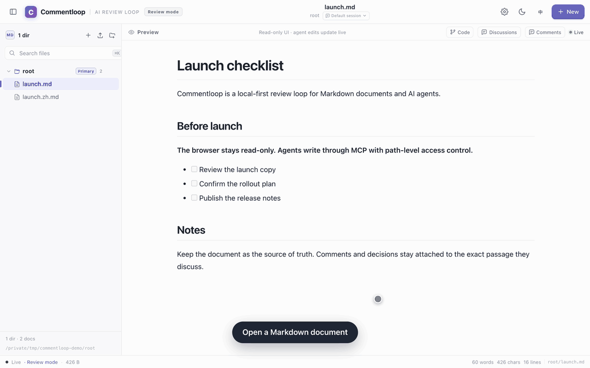

[](https://github.com/HZHENGZHI/commentloop/actions/workflows/ci.yml)

# Commentloop

[English](README.md) | 简体中文

本地优先的 AI 协作审阅循环。

浏览器只负责阅读、评论和审阅；Agent 通过 MCP/CLI 修改文档。评论、修改前后、共识和回滚都围绕同一份 Markdown 发生，文档本身是最终结果。

```text
用户评论 → Agent 修改 → 用户审阅 → 继续评论 / 回滚 → 文档更新
```



## 主要能力

- **行内评论**：选中文字评论，评论锚定到原文；支持 Thread、关联组、局部回滚。
- **Agent 改稿**：Agent 读取文档、评论和共识，写回修改，并回复修改前后内容。
- **文档共识**：导入 Pi / Claude Code / Codex / Cursor 会话，提炼成结构化共识；后续修改可以参考，避免反复推翻早先决定。
- **代码上下文**：文档可以关联本地目录或 GitHub 仓库；Agent 可以只读查看代码、Git 状态和分支。
- **本地优先**：Go 单二进制 + React 前端，默认只监听 `127.0.0.1`；评论和会话保存在本地 SQLite。
- **前台只读**：默认审阅模式，已有文档不能从浏览器编辑；Agent 写入仍经过后端路径和权限校验。

## 快速开始

需要 Go 1.26+、Node.js 22+（仅构建前端时需要）。

也可以直接从 [Releases](https://github.com/HZHENGZHI/commentloop/releases) 下载 macOS / Linux 的 amd64 / arm64 二进制。

```bash
git clone https://github.com/HZHENGZHI/commentloop.git
cd commentloop
make build
```

启动并打开一个笔记目录：

```bash
./bin/commentloop ~/Documents/notes
```

默认地址是 http://127.0.0.1:4571/ ，启动后会自动打开浏览器。

也可以同时添加多个目录，或直接打开某个 Markdown 文件：

```bash
./bin/commentloop ~/Documents/notes --add-dir ~/obsidian-vault --add-dir /Volumes/work/wiki
./bin/commentloop ~/Documents/notes/当前笔记.md
```

后台管理：

```bash
./bin/commentloop status
./bin/commentloop stop
```

需要前台日志或交给 launchd/systemd 时：

```bash
./bin/commentloop run --no-open ~/Documents/notes
```

### 第一次使用

1. 打开页面，左侧选择文档。
2. 在预览中选中文字，写评论。
3. 在评论里选择任务类型；Agent 完成后会回复“修改前 / 修改后”。
4. 你决定继续、回滚，或标记评论已解决。只有用户能关闭评论。

## 接入 Agent

### MCP

Agent 通过 stdio 启动 `commentloop mcp`：

```json
{
  "mcpServers": {
    "commentloop": {
      "command": "/Users/you/Desktop/coding/commentloop/bin/commentloop",
      "args": ["mcp"]
    }
  }
}
```

Cursor 需要在 `~/.cursor/cli-config.json` 允许：

```json
{
  "permissions": {
    "allow": ["Mcp(commentloop:*)"]
  }
}
```

建议同时禁止 Cursor 自带的 `Shell(*)` / `Write(**)`，避免绕过 Commentloop 的路径控制。

### 自动运行

设置 → 后台 Code Agent：

- **嵌入 Pi**：由 Commentloop 进程直接启动 Pi。
- **外部 Agent Runner**：由宿主机上的 Runner 领取任务并启动本机 Agent。

外部 Runner 示例：

```bash
./bin/commentloop agent-runner --url http://127.0.0.1:4571 --agent-type pi
./bin/commentloop agent-runner --url http://127.0.0.1:4571 --agent-type claude-code
./bin/commentloop agent-runner --url http://127.0.0.1:4571 --agent-type codex
./bin/commentloop agent-runner --url http://127.0.0.1:4571 --agent-type cursor
```

支持 `--once`（处理一个任务后退出）、`--command`（自定义 Agent 命令）和 `--prompt-mode stdin`。

Runner 会向 Agent 注入一次性的 `COMMENTLOOP_URL` / `COMMENTLOOP_AGENT_TOKEN`；Agent 必须已经配置好 Commentloop MCP。

### CLI

```bash
./bin/commentloop agent info
./bin/commentloop agent list --refresh
./bin/commentloop agent read notes/todo.md
printf '# Hello\n' | ./bin/commentloop agent write notes/hello.md
./bin/commentloop agent search todo
./bin/commentloop agent changes --since 30m
```

## 配置和数据

默认数据目录：

```text
macOS: ~/Library/Application Support/commentloop/
Linux: ~/.config/commentloop/
```

主要文件：

```text
commentloop.db     SQLite：目录、评论、会话、共识、任务
commentloop.log    后台日志
server.json        当前实例的 URL / PID
```

文档本身仍然是普通 Markdown；评论和共识不写入 Markdown。

常用参数：

```bash
--addr 127.0.0.1:4571   # 监听地址
--state-dir DIR         # 自定义状态目录
--no-open               # 不自动打开浏览器
--no-state              # 不读写状态
--add-dir DIR           # 追加工作区目录
```

默认审阅模式下：

- 已有文档不能从浏览器修改：`PUT /api/doc` 返回 403。
- 新建、导入、删除文档仍可用。
- Agent 通过 MCP/CLI 写入，后端会校验文档路径、关联代码仓库和任务能力。

## Docker

```bash
make cross
docker build -t commentloop .

docker run -d --name commentloop \
  -p 127.0.0.1:4571:4571 \
  -v "$HOME/Documents/notes:/notes" \
  -v commentloop-data:/data \
  commentloop
```

容器内前台运行 `commentloop run --no-open --addr 0.0.0.0:4571 /notes`；`/data` 保存 SQLite、日志和 discovery 文件。

## 开发

```bash
make test          # Go 测试 + 前端构建
make debug DIR=~/Documents/notes
make dev-backend   # 终端 1
make dev-web       # 终端 2
make cross         # macOS / Linux amd64 + arm64
```

`make debug` 同时监听前端和 Go 代码：前端改动刷新页面，后端改动自动重启并让页面重连。

## 发布

推 `v*` tag 会自动：

- 构建 macOS / Linux 的 amd64 + arm64 二进制；
- 生成 `.tar.gz` 和 `SHA256SUMS`；
- 创建 GitHub Release 并上传产物。

```bash
git tag v0.1.0
git push origin v0.1.0
```

## License

MIT
